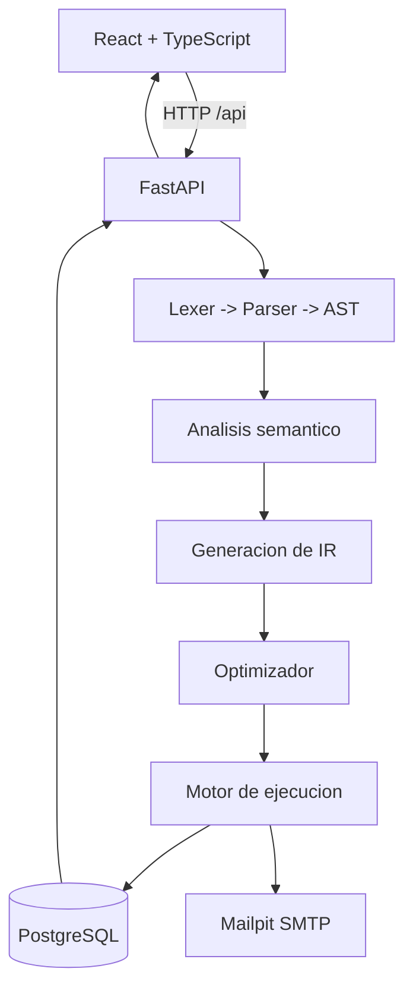

# Arquitectura de SmartHome · Etapa 2

## Vision general

## Limites de responsabilidad

- **Frontend**: consola, tarjetas visuales, estados, errores e historial. Nunca interpreta comandos.
- **API FastAPI**: contratos HTTP, validacion de peticiones HTTP, orquestacion del interprete.
- **Interprete**: analiza el programa completo antes de ejecutarlo. No depende de React.
- **Persistencia**: estados, historial y notificaciones en PostgreSQL (etapa 5).
- **SMTP**: entrega de prueba a Mailpit (etapa 11); no enviamos correos externos.

## Componentes actuales de etapa 2

- `/api/ping`: confirma que FastAPI responde sin necesitar servicios externos.
- `/api/health`: comprueba la conectividad PostgreSQL e informa la configuracion SMTP, **sin probar envio**.
- React consume `/api/health` usando el proxy de Vite.
- Docker Compose prepara frontend, backend, postgres y mailpit.

## Contratos HTTP previstos (NO implementados aun)

| Metodo | Ruta prevista | Proposito | Etapa |
|---|---|---|---|
| POST | `/api/programas/ejecutar` | Validar/optimizar/ejecutar varias lineas | 7-10 |
| GET | `/api/dispositivos` | Consultar identificadores, tipos y estados | 5/10 |
| GET | `/api/historial` | Consultar ejecuciones | 10 |
| GET | `/api/notificaciones` | Consultar mensajes | 10-11 |

**Respuesta futura de errores:** categoria, linea, columna opcional y descripcion.

## Reglas arquitectonicas

1. La sintaxis se rige por `Diseno_lenguaje_SmartHome.pdf` (v1.0) y no debe cambiarse sin versionarla.
2. El programa se valida completo antes de ejecutar cualquier instruccion.
3. No se optimizan SEND_EMAIL ni NOTIFY ni las lecturas observables.
4. El historial distingue instrucciones recibidas y operaciones fisicas cuando haya optimizacion.
5. Las credenciales solo viven en `.env` (ignorado por Git) o en secretos de despliegue.
